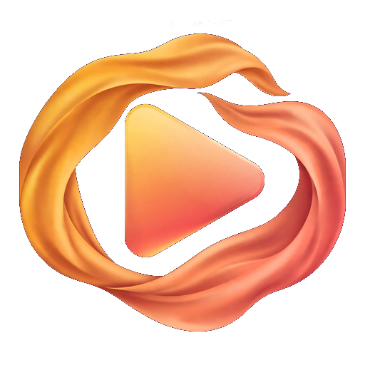

<p align="center">
  
</p>

<p align="center">
  
</p>

<h1 align="center">YouGlideTube Desktop</h1>

<p align="center"><b>Buttery smooth. Truly yours.</b></p>

<p align="center">
  <a href="https://github.com/shivytyahoo/YouGlideTube-Desktop/releases/tag/v0.1.0-beta4"></a>
  <a href="https://github.com/shivytyahoo/YouGlideTube-Desktop/releases"></a>
  
  <a href="LICENSE"></a>
</p>

<p align="center">
  <a href="https://github.com/shivytyahoo/YouGlideTube-Desktop/releases"><b>⬇️ Download YouGlideTube Desktop</b></a><br>
  <sub>Windows installer, macOS DMG and Linux packages — see <a href="#install">Install</a> below</sub>
</p>

## About

**YouGlideTube Desktop** is the desktop version of
[YouGlideTube for Android](https://github.com/shivytyahoo/YouGlideTube)
by [Shivyt](https://github.com/shivytyahoo) — the same fast,
buttery-smooth YouTube client, with the same look, feel and features,
rebuilt for the desktop: a sidebar and top search instead of a phone
screen, a native player, Google sign-in, downloads and a clean,
distraction-free interface, on Windows, macOS and Linux.

The project is distributed under the GNU General Public License v3.0.
See [LICENSE](LICENSE) for the full text.

| | |
|---|---|
| **App** | `io.github.shivytyahoo.glidetube.desktop` |
| **Latest release** | [0.1.0-beta4](https://github.com/shivytyahoo/YouGlideTube-Desktop/releases/tag/v0.1.0-beta4) |
| **Requires** | Windows 10 22H2+, macOS 13+, or Ubuntu 22.04+ / Debian 12+ (and comparable modern distributions) |
| **License** | GPL-3.0 |

## 🎨 Look and feel

Open YouGlideTube Desktop and the first thing you notice is that it
does not look like a clone of anything. The interface is dark-first and
calm: a deep `#1A1C1E` canvas, a blue-to-teal brand (`#1E5AA8` →
`#00AFAE`), and warm saffron and coral accents on the mark and the
player — the same look as the Android app, laid out the way a desktop
app should be.

- **Sidebar and top search** — your Home, Shorts, Subscriptions,
  Library and Music sit in a slim sidebar, with search always in the
  top bar, the way YouTube on the desktop works.
- **Glass surfaces** — the top bar, sidebar, player controls and mini
  player are soft glass over the feed, instead of flat strips.
- **Cards coloured from their own thumbnails** — every video card picks
  its colours from its thumbnail, so the feed feels hand-made for what
  you are looking at, not stamped from a template.
- **Boxy cards with real gaps** — cards sit in their own space with
  proper gaps on every screen, Home, Search, Subscriptions, Library,
  everywhere. Nothing ever looks stuck together.
- **Smooth by design** — a scratch launch animation, Glide-style loading
  and transitions that stay out of your way.

The result is an app that feels considered rather than assembled: quiet
where it should be quiet, colourful exactly where your videos are, and
fast everywhere. It is the kind of interface you enjoy opening, not just
tolerating.

## ⚡ What's new in 0.1.0-beta4

The first desktop release — the Android app, on the desktop.

- **Google sign-in, the Android way** — sign in on Google's own page in
  a window inside the app, and the home feed reloads signed-in; a
  cookie-paste option is there if Google refuses the in-app window
- **Your account, on the server** — subscriptions, watch history and
  Watch Later now come from your Google account, not just the device:
  subscribe from any card, clear your server history, save to Watch
  Later and it saves on the server
- **Multiple accounts** — add more than one Google account and switch
  between them from Settings → Google account
- **Home feed is fully YouTube's now** — the feed comes from YouTube's
  own home browse, signed-in or anonymous, with YouTube's chips
- **Music, the Android way** — Listen Again, On Repeat, Speed Dial,
  Quick Picks, Daily Discover, Daily Mixes and Similar To shelves, a
  pitch slider, and endless radio
- **The Android look** — the Android logo, the Android onboarding, and
  glass top bar, sidebar, player controls and mini player

See [CHANGELOG.md](CHANGELOG.md) for the full list.

## Features

### ⚡ Playback

- **Instant, buttery playback** — fast direct streams, so the next video
  is ready before you tap it
- **Quality and codec selection**, chapters, subtitles, playback speed,
  queues, a mini player, picture-in-picture and background audio
- **Live streams play** through your signed-in session
- **Shorts** with the same smooth player — swipe through with the
  keyboard or the on-screen chevrons

### 🎬 Home feed

- **Your home feed is YouTube's own** — signed-in or anonymous, in
  YouTube's order, with YouTube's chips
- **Subscriptions top up the feed**, with a related lane from your watch
  history and likes
- Dismissed and blocked channels stay out of the feed

### 🔔 Notifications

- **In-app inbox** for new uploads from your subscriptions, with an
  unread badge on the bell — grouped as New, Today, Yesterday, Last 7
  days and Earlier
- **System notifications** for new videos, on a check interval you
  choose — 15 minutes to 24 hours
- Pull to refresh the inbox any time; dismiss one video or clear them all

### 👤 Your account, done right

- **Sign in with your Google account** right in the app, with
  **multiple accounts**
- No companion services app is needed for sign-in
- Your sign-in cookie stays on this device, is never backed up, and is
  only sent to YouTube
- **Watch history syncs with your YouTube account** — videos watched in
  YouGlideTube Desktop appear in YouTube history on every device, and
  the other way round
- **Clear All and Delete remove videos from your server history too**,
  not just the local list — and they stay gone after refresh
- **Playlists that actually load** — your full list, Watch Later that
  saves on the server, and a Library whose counts and thumbnails update
  the moment you change anything
- **Library and History keep your latest watches and likes on top**,
  across restarts

### 💬 Comments and live chat

- **Comments that work** — post, reply, edit, delete and like, including
  replies inside threads
- **Live chat** — send messages and remove your own

### 🔍 Search that finds things

- Search across videos, Shorts, live streams, channels and playlists,
  with filters for type, duration, upload date and sort order
- **The Shorts filter shows Shorts**, the Videos filter shows videos —
  each filter returns what it promises
- Search history is saved on the device and survives restarts, with
  separate history for video and music searches

### 📥 Downloads

- **Offline downloads** with quality and format choice
- **Multi-audio downloads** — tick more than one audio track, Hindi and
  English together, and the download carries both
- Subtitles, a lyrics file and tags on your downloads
- Download location and cache controls in Settings

### 🎵 Discovery and music

- Home feed, subscriptions, search, categories, channels and playlists
- **Music mode with lyrics** — synced lyrics, source choice and
  auto-romanization
- **Listen Again, On Repeat, Speed Dial, Quick Picks, Daily Discover,
  Daily Mixes and Similar To** — the session shelves from the Android app
- **Pitch control** and **endless radio** for music playback
- Music crossfade, a customizable mini player and an equalizer

### 📱 Doubles as a media player

YouGlideTube Desktop is not only a YouTube client — it works as a media
player for what is already on your computer:

- **Library → Local media** scans your folders and plays their videos
  and music in the same player
- **Downloads play offline**, no connection needed
- The same player extras carry over: **background audio**,
  **picture-in-picture** and the **equalizer**

### 🧩 Community enhancements

- **SponsorBlock** — skip sponsored segments and more
- **DeArrow** — crowdsourced titles and thumbnails
- **Return YouTube Dislike** — dislike counts, back where they belong
- **Discord Rich Presence** — show what you are watching

### 🎨 Make it yours

- Themes, fonts and glass blur
- Home layout, local media, wellbeing tools and in-app diagnostics
- **Imports** — bring your library from YouGlideTube backups, Google
  Takeout, NewPipe, LibreTube, FreeTube and OPML

### 🔒 Privacy

- **No ads, no analytics, no telemetry** — and no Google account is
  required
- History, settings and library data are stored locally in SQLite on
  your computer
- The app contacts YouTube, and the optional services you turn on
  (SponsorBlock, DeArrow, Return YouTube Dislike, lyrics providers),
  and nothing else

## Why you will enjoy it

YouGlideTube Desktop is built around one idea: **you should never wait
for the app**. Videos start before you press play. Shorts glide past
without a single loading pause. Your subscriptions tell you when
something new is up, your history follows you across devices, and the
whole thing looks and feels like it was designed — because it was,
screen by screen, gap by gap.

It is a serious project, built with care over many late nights, and it
shows in the small things: the glass that softens instead of shouting,
the cards that never touch, and the sign-in that works the way the
Android app's does. And when you move to the desk, it is there too: the
same app on Windows, macOS and Linux, with the same feed and the same
look, built for the keyboard and the big screen.

## 🙏 Credits and thanks

YouGlideTube Desktop stands on the shoulders of open source. None of
this exists without the projects and people below, and this project is
grateful to every one of them.

- **[Flow Desktop](https://github.com/Flow-Tube/Flow-Desktop)** —
  special thanks to the original Flow developers for the open-source
  foundation and the work that helped make YouGlideTube Desktop
  possible.
- **[NewPipe](https://github.com/TeamNewPipe/NewPipe)** — the pioneering
  open-source YouTube client. The independent-client ecosystem owes
  NewPipe and its contributors a debt for proving this could be done in
  the open.
- **[Morphe Manager](https://github.com/MorpheApp/morphe-manager)** —
  design inspiration for this interface. The dark-first surfaces,
  blue-to-teal brand and glass cards take cues from Morphe Manager's
  look; its name and logo are not used here.
- **The InnerTube open-source community** — the researchers and
  developers behind YouTube.js, yt-dlp and the many independent clients
  whose protocol work makes projects like this possible at all.
- **The libraries that carry the app** — Tauri 2, React 19 and
  TypeScript, Rust (tokio, reqwest, sqlx), dash.js and hls.js, Zustand,
  Tailwind CSS, Vite, and the Tauri plugins.
- **SponsorBlock, DeArrow and Return YouTube Dislike** — community
  projects that make YouTube better for everyone, kept working here.
- **Shivyt ([shivytyahoo](https://github.com/shivytyahoo))** — design,
  development and every late night in between.

If this project makes your day a little better, the credit belongs to all
of the above.

See [CREDITS.md](CREDITS.md) for the full list.

## Screenshots

Fresh screenshots of the desktop app are being added here.

## Install

| Platform | Supported versions | Architectures | Packages |
| --- | --- | --- | --- |
| Windows | Windows 10 22H2, Windows 11 | x64, ARM64 | NSIS installer |
| macOS | macOS 13 Ventura or later | Intel x64, Apple Silicon | DMG |
| Linux | Ubuntu 22.04+, Debian 12+, and comparable modern distributions | x64, ARM64 | AppImage, `.deb`, `.rpm` |

1. Download the installer for your system from
   [Releases](https://github.com/shivytyahoo/YouGlideTube-Desktop/releases).
2. Install it (Windows: run the `.exe`; macOS: drag the app to
   Applications; Linux: `sudo apt install ./YouGlideTube_*.deb` or run
   the AppImage). If Windows has no WebView2, the installer downloads
   the runtime first.
3. Open the app and sign in from the top bar, or skip and sign in later.

- **Stable:** reviewed releases intended for normal use.
- **Beta / RC:** public GitHub prereleases for wider testing. These
  install as **YouGlideTube Beta** with isolated application data.
- **Nightly:** automatic snapshots from `main`. These install as
  **YouGlideTube Nightly**, use isolated data, and may be unstable.

In-app updates are **not set up yet**: the app has no update server
configured, so Settings → About says so instead of offering a check.

## Build from source

```sh
git clone https://github.com/shivytyahoo/YouGlideTube-Desktop.git
cd YouGlideTube-Desktop
pnpm install --frozen-lockfile
pnpm tauri dev          # run the app from source
```

Build packages for the current operating system (no update signing needed):

```sh
pnpm tauri:build:local  # tauri build with updater artifacts off
```

Artifacts land in `src-tauri/target/release/bundle/`:

| Platform | Artifacts |
| --- | --- |
| Windows | `nsis/YouGlideTube_<version>_x64-setup.exe` (and `arm64`) |
| macOS | `dmg/YouGlideTube_<version>_x64.dmg` (and `aarch64`) |
| Linux | `deb/YouGlideTube_<version>_linux_<arch>.deb`, `rpm/…rpm`, `appimage/YouGlideTube_<version>_linux_<arch>.AppImage` |

Requirements: Node.js 22.12+, pnpm 11.9+, stable Rust, and the
[Tauri 2 prerequisites](https://v2.tauri.app/start/prerequisites/) for
your operating system. Linux builds need a compatible glibc, GTK 3 and
WebKitGTK 4.1 environment. See [docs/LINUX.md](docs/LINUX.md) for which
package to pick.

A full release build (with updater artifacts and signing) is what the
GitHub Actions release workflow (`.github/workflows/release.yml`) does:
it builds Windows, macOS and Linux packages per architecture, signs the
updater artifacts, and publishes them to GitHub Releases.

## Troubleshooting

### Opening YouGlideTube on macOS

YouGlideTube isn't signed with an Apple Developer ID or notarized yet, so
the first launch is blocked with a message such as "Apple could not
verify YouGlideTube is free of malware" or "YouGlideTube is damaged and
can't be opened". To open it:

1. Open the DMG and drag YouGlideTube into your Applications folder.
2. In Terminal, remove the download mark macOS puts on the app:

   ```sh
   xattr -dr com.apple.quarantine /Applications/YouGlideTube.app
   ```

   For a Beta or Nightly build, use `"/Applications/YouGlideTube Beta.app"`
   or `"/Applications/YouGlideTube Nightly.app"`, with the quotes.
3. Open YouGlideTube as usual.

Without Terminal: try to open YouGlideTube once, then go to
**System Settings > Privacy & Security**, scroll down to the message about
YouGlideTube and click **Open Anyway**.

### Linux media codecs

On Linux, video decoding goes through WebKitGTK and the system GStreamer
plugins (Windows and macOS ship their own decoders). If audio plays but
video stays frozen on a spinner, a video decoder is missing.

- **AppImage** — bundles the required GStreamer codec plugins (including
  `gst-libav` for H.264); no system codec packages are needed.
- **`.deb`** — declares the codec plugins as dependencies. Install with
  `sudo apt install ./YouGlideTube_*.deb` so they are pulled in
  automatically.
- **`.rpm`** — the freely licensed plugins are hard dependencies. On
  Fedora, a full H.264 decoder is only available through
  [RPM Fusion](https://rpmfusion.org/Configuration) for patent reasons
  (Fedora's own OpenH264 can't decode most YouTube video): enable RPM
  Fusion and run `sudo dnf swap ffmpeg-free ffmpeg --allowerasing` and
  `sudo dnf install gstreamer1-plugin-libav`, or use the AppImage instead.
  Without it, YouGlideTube plays VP9, which Fedora always has.

### Linux startup crashes and blank windows

If the app opens to a blank or white window, that is usually the WebKitGTK
DMABUF renderer failing on your graphics stack (common with NVIDIA
proprietary drivers and some Wayland sessions). YouGlideTube disables it
automatically and, if a launch still fails to render, **escalates GPU
workarounds on the next launch on its own**: first forcing software
compositing (`WEBKIT_DISABLE_COMPOSITING_MODE=1`), then falling back to
X11/XWayland (`GDK_BACKEND=x11`). A clean launch resets this.

If the app aborts on startup with `Could not create default EGL display: EGL_BAD_PARAMETER` (seen on some Arch-family / Mesa systems with the **AppImage**), that is a known Tauri AppImage packaging issue: a bundled `libwayland` client library conflicts with your system's newer Mesa/EGL stack. As an interim workaround, delete the bundled Wayland libraries and run the extracted app:

```sh
./YouGlideTube_*_linux_amd64.AppImage --appimage-extract
rm squashfs-root/usr/lib/*wayland*so*
./squashfs-root/AppRun
```

The `.deb`, `.rpm` and the Flatpak use the system's or the runtime's own
libraries and avoid this class of issue; prefer those when the AppImage
fails.

## Changelog

See [CHANGELOG.md](CHANGELOG.md) and
[Releases](https://github.com/shivytyahoo/YouGlideTube-Desktop/releases).

## Disclaimer

YouGlideTube Desktop is not affiliated with, endorsed by, or sponsored by
Google or YouTube. YouTube is a trademark of Google LLC.

## License

YouGlideTube Desktop is distributed under the **GNU General Public License v3.0**.
See [LICENSE](LICENSE) for the full text.

It is based on open-source code (GPL-3.0-only); see [CREDITS.md](CREDITS.md).

This license requires that any project using this source code must also be released as open source under GPLv3. It may not be used in a proprietary or closed-source application.
